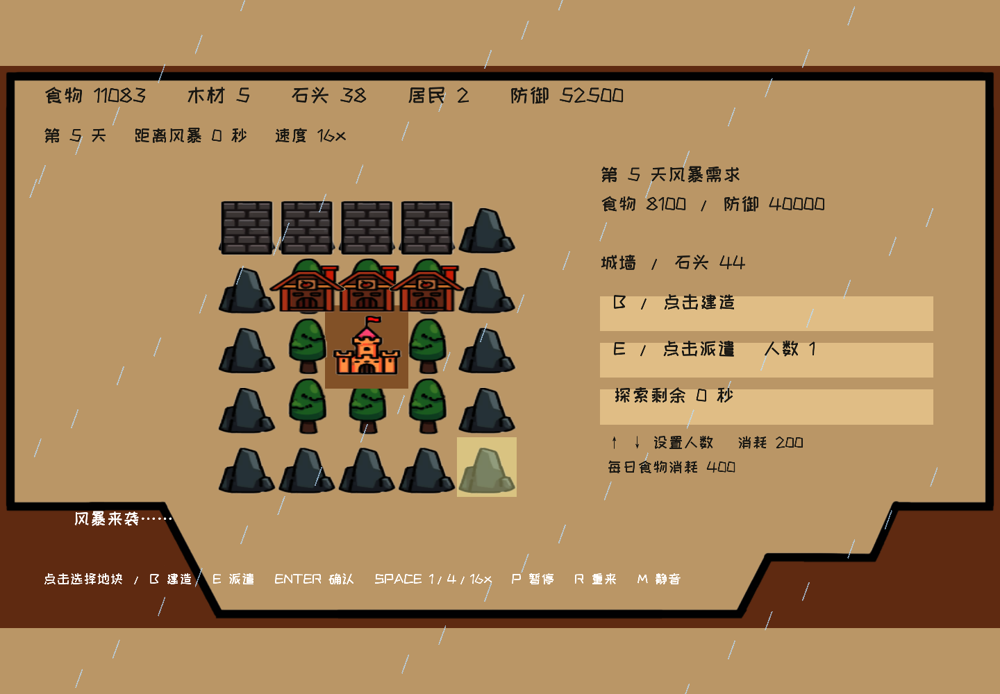

# Shelter 交付与性能验证

2026-10-17，已发布到 https://www.tcfun.fun/games/shelter ，Netlify 部署 `6ad351e545a44a54c191985e`。线上 TCPAK、源码 ZIP 与截图均逐项 SHA-256 核对通过，实际播放器启动、输入与退出通过。

## 交付

主页示例列表已增加 `/games/shelter`，与 Return、Rougelike、Physics Lab 一起在桌面精选区域轮播实际截图。游客可游玩、全屏、下载源码 ZIP。实际运行的是 Tc native cooker 编译出的 C# 程序集与 TCPAK，图片、文字、音乐均走 Tc 组件；没有用网页覆盖层替代游戏逻辑。

- 工程：`samples/shelter/Project.tcproj`。
- 玩法、原版对照、已修正问题、重建及测试命令：[示例 README](../samples/shelter/README.md)。
- 包：30,157,291 字节 / 15 条资源；SHA-256 `813c5b31aadbeecb3c5924b5a3d4e7cc5eb39b3bf7f28199e74176b2ce5ac51c`。
- 引擎仍锁定 `5734c56ae05241b01a684afb8e62f2b164c69ba2`。此次优化可由示例结构完成，没有改上游，也没有产生上游 PR。

## 性能改动与实测

原 demo 每栋生产建筑分别运行协程、每帧刷新文字并扫描对象集合。本版使用固定数组、统一一秒模拟时钟、限幅帧步长、固定 1/4/16 倍速、按脏值写入组件、最多约 6.7 次/秒刷新 HUD，以及启动阶段字形准备。

最初逐个移动 48 个雨滴的版本，风暴 P95 约 16.9 ms。改为两条重复雨带挂在同一父对象，只更新一次父 Transform。随后在实际可见雨效回归中捕获首次启用雨滴的 52.66 ms 尖峰，因此把雨滴准备到屏幕外，天气切入仅移动父对象。最终 storm-entry 最大耗时为 14.00 ms，稳定雨效 P95 为 4.32 ms。这里的中间版本数据用于定位原因，最终性能结论以下表和最终包哈希为准。

测试环境：Chrome headless，Intel UHD Graphics / ANGLE D3D11，页面 1440×1000；实际生产构建与真实 WASM，社区 API 仅做列表/匿名会话夹具。实测回调节奏约 176–180 Hz，不应把它当成所有屏幕的显示 FPS。

| 阶段 | PlayerFrame P95 ms | 最大 ms | 帧间隔 P95 ms | 最大间隔 ms | >33.8 ms 次数 |
|---|---:|---:|---:|---:|---:|
| settlement-1x | 5.07 | 17.45 | 6.04 | 17.68 | 0 |
| paused | 4.86 | 9.60 | 5.93 | 9.92 | 0 |
| production-16x | 5.45 | 11.12 | 6.23 | 11.81 | 0 |
| input-burst | 6.39 | 12.91 | 6.89 | 16.57 | 0 |
| fullscreen-16x | 3.46 | 6.89 | 5.85 | 7.38 | 0 |
| storm-entry | 3.27 | 14.00 | 5.83 | 17.43 | 0 |
| storm | 4.32 | 5.47 | 5.84 | 6.47 | 0 |

所有阶段满足本机 `TEST_SHELTER_CPU_P95_MS=8` 门槛。WASM heap 全程为 161,087,488 字节（约 153.6 MiB），未增长。退出后 iframe 为零，所有观测 AudioContext 均关闭，运行期间音频上下文为 running。

CPU 是同步 PlayerFrame 执行和提交时间，帧间隔是调用间隔，均不等于 GPU 完成或屏幕呈现时间。本次没有 >33.8 ms 间隔；存在个别约 17 ms 的间隔，不能承诺任意设备绝对不掉帧。稳态性能不包括首次下载、WASM 启动和截图本身。storm-entry 阶段覆盖天气切入，未把该尖峰从采样中排除。

[机器可读记录](shelter-performance.json) 保存阶段统计、真实加载引擎文件哈希、包哈希、源码哈希与内存检查点。完整逐帧数据位于本地 `.engine/shelter-qa/2026-10-17T06-46-34.432Z/evidence.json`。

## 验证结果与边界

- Tc C# 编译 / native cook / 全资源 SHA-256 校验通过。
- `npm run build` 通过。既有 Monaco 大分块提示仍存在，与游戏帧循环无关。
- `node --test tests/shelter.test.mjs`：3/3 通过，包括完整下载工程与当前源码逐文件一致。
- `dotnet run --project tests/shelter-model -c Release --no-restore`：数值、非法输入、重复建造/领取、生产、每日消耗、六轮风暴、唯一建筑销毁、胜负和结果冻结通过。额外以原始初始资源执行四农场/四城墙策略，完整通过 29 天；没有注入额外资源。
- 浏览器普通鼠标/键盘覆盖主页入口、开始、地块边界、建造与重复建造、派遣/领取、暂停、16 倍速、连续输入、全屏、第一轮风暴与继续、重开、关闭资源释放。未用调试按键、替换场景或修改游戏私有状态。六轮完整数值通关由上述独立 C# 模型回归覆盖，浏览器没有连续游玩全部六轮。
- 初次全仓检查发现既有 Return 源码 ZIP 与 `ReturnGame.cs` 不一致。正式发布前使用当前源文件和锁定 Tc 工具链重新 cook，源码 ZIP 同步生成并验证；最终全仓 `npm test` 为 58/58 通过（包含新增的旧封面兼容性回归）。

