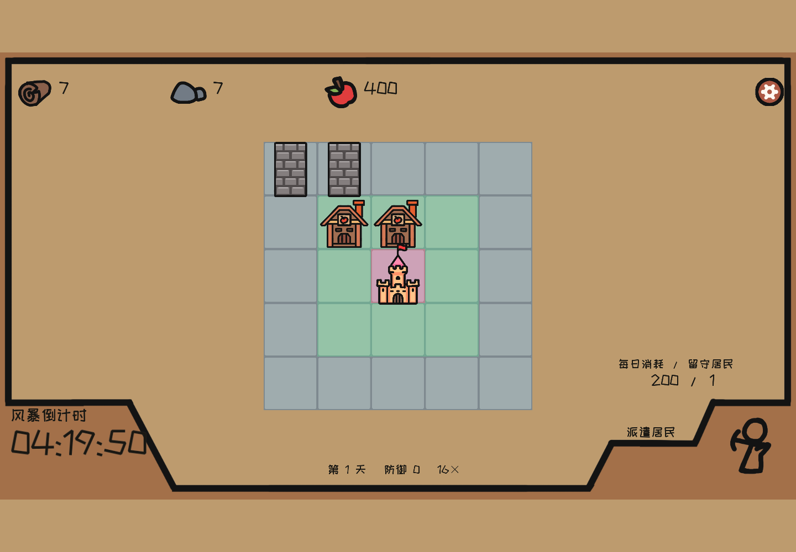

# Shelter 交付与性能验证

2026-10-17。本次按原 Unity 工程更正地图、建筑比例与鼠标交互，完成最终构建的本地验收，并发布到 https://www.tcfun.fun/games/shelter 。Netlify 部署 ID 为 `6ad3637c85e10d28709df848`，记录在 `.engine/shelter-restoration-deploy.json`；线上资源哈希、29 项交互回归及首次成功风暴后的继续流程均通过。当前环境的显示帧率稳定性仍未通过验证，详见性能边界。

## 当前交付

首页保留 Return、Shelter、Rougelike、Physics Lab 四个示例，桌面精选区自动切换实际游戏截图。Shelter 支持游客游玩、全屏与源码 ZIP 下载。游戏由 Tc native cooker 编译的 C# 程序集和 TCPAK 运行，图片、文字、音乐使用 Tc 组件。

- 工程：`samples/shelter/Project.tcproj`；玩法、重建命令及明确移植差异见 [示例 README](../samples/shelter/README.md)。
- 依据原场景 GUID 绑定恢复 `main.png`、`Resource.png`、`build.png` 地图和 500×800 建筑；原 Unity 实际截图与 Tc 对照见 [复原记录](shelter-restoration.md)。
- 最终 TCPAK：54,589,589 字节、30 条资源，SHA-256 `803042e74343c8220664f52f2afec41a7b8d5b0d0f5f15f80b5343ed4529d8f0`。
- 最终源码 ZIP：21,269,628 字节，SHA-256 `052fb67a1e2f3345043a7ec9d5fa93998243fcc23e82abbce6c93052964da6ab`。下载工程与当前源码一致，包含更正后的原版 8 秒 / 移植版 9 秒雨幕说明。
- 引擎锁定 `c28487215bd5df89b35c1d68252ba240231d9c4f`。运行时及部署目录精确复用现有 `web-engine-c2848721` release，190 个资源逐文件哈希校验通过；manifest cache hash 为 `8f71d13105965ddc72de90989971b33c9521e6482b2633f4becb16179629eb19`。

## 性能修正与最终实测

旧引擎的 WebGL 清屏路径每帧读取 `GL_COLOR_CLEAR_VALUE`，CPU 剖析中约 4 秒的采样有 3.6 秒耗在同步查询。上游 [PR #33](https://github.com/chnnasn/TomCat_Engine/pull/33) 已在本次工作之前合并，改为跟踪清屏颜色。本次复用该修复升级引擎，没有重复提交或声称新建这个 PR。示例保留统一模拟时钟、按变化更新组件和预建雨带，并取消播放器弹窗背景的实时模糊；账号弹窗保留原模糊效果。

最终性能测试独立运行 Chrome headless 155.0.8059.82，1440×1000、DPR 1、Intel UHD / ANGLE D3D11，使用最终生产构建、最终 CSS、上述 TCPAK 与发布版引擎。采样时没有并行构建、其他浏览器基准或 DevTools profiler。嵌入绘制缓冲为 758×550，全屏为 1440×1000。

| 阶段 | PlayerFrame CPU P95 ms | CPU 最大 ms | 调用间隔 P50 ms | 调用间隔 P95 ms | 最大间隔 ms | 间隔 >33.84 ms 次数 |
|---|---:|---:|---:|---:|---:|---:|
| initial-1x | 5.89 | 9.29 | 27.80 | 66.35 | 94.62 | 39 |
| settings-paused | 4.81 | 6.46 | 30.41 | 65.80 | 73.96 | 45 |
| production-16x | 6.32 | 7.65 | 24.40 | 62.97 | 72.94 | 43 |
| fullscreen-16x | 7.14 | 9.50 | 61.40 | 126.55 | 138.92 | 35 |
| storm-entry-16x | 4.54 | 13.85 | 53.99 | 107.44 | 251.43 | 1268 |
| storm | 5.47 | 5.97 | 65.96 | 114.61 | 141.53 | 76 |
| result-transition | 5.25 | 23.15 | 55.74 | 103.44 | 147.51 | 56 |

各阶段均通过 `TEST_SHELTER_CPU_P95_MS=8` 的本机 CPU 预算，但实际调用间隔仍然较差，不能据此宣称稳定 60 FPS 或不掉帧。该次 QA 同时观察到用户的 Return Unity 6 编辑器、壁纸程序与桌面合成器占用 GPU；这些应用没有被关闭。该观察说明测试环境存在其他 GPU 负载，没有受控实验可把全部间隔波动归因于某一个进程。请求高性能 GPU 的诊断实验仍使用 Intel UHD，没有把无实效的实验配置加入正式代码。

CPU 指同步 `PlayerFrame` 执行及提交时间，调用间隔也不等于 GPU 完成或屏幕呈现时间。采样包括自然进入第一场风暴、雨幕和结果切换；首次下载、WASM 启动、哈希校验及截图不计入稳态测量。此次浏览器性能流程建造两农场、两城墙，在第一轮风暴进入失败结果窗口，覆盖结果切换与释放，不代表生存成功或完整通关。

15 个内存检查点的 WASM heap 均为 193,331,200 字节，未增长。观测到的音频上下文运行时为 `running`，关闭后为 `closed`，iframe 数量为 0；此短时检查不等同于长期无泄漏证明。

[机器可读记录](shelter-performance.json) 保留原始阶段统计、heap、清理、实际引擎文件与包哈希、源码哈希及原证据路径，省略逐帧 samples。完整原证据：`.engine/shelter-performance-qa/2026-10-17T11-57-00.475Z-4988/evidence.json`。

## 验证与边界

- Tc C# 编译、native cook、TCPAK 资源校验、`npm run build` 通过；既有 Monaco 大分块提示仍存在。
- 全仓 `npm test`：60/60 通过。更正雨幕说明并重建 ZIP 后，`node --test tests/shelter.test.mjs` 再次 5/5 通过，包含场景 GUID → 原图 → 导入清单 → 运行时 handle 的映射与建筑尺寸回归。
- 原 Unity 工程只读复制后使用对应 Unity 2021.3.24f1c1 运行，保留菜单、初始地图、建造预览、派遣预览、设置共七张参考截图；截图流程没有实际执行建造或派遣。捕获说明和原文件核对见 `.engine/shelter-unity-reference/reference-notes.md`。
- 普通鼠标交互完成 29 个检查点：建造确认/取消、占用和资源不足、派遣滑块快速点击及拖动上下限、取消不扣费、完成报告不可被 P/Esc 绕过、领取不可重复、全屏、暂停冻结、返回菜单再开局。未注入游戏私有状态。证据：`.engine/shelter-ui-qa/2026-10-17T11-36-39.175Z/evidence.json`。
- 独立 C# 模型从原始资源 400 食物 / 10 木材 / 10 石材 / 1 居民出发，以四农场、四城墙策略通过第 29 天六轮风暴，没有注入额外资源；同时覆盖非法输入、重复建造/领取、生产、消耗、不同建筑销毁、胜负与结果冻结。证据：`.engine/shelter-model-final.log`。浏览器没有连续游玩全部六轮。
- 真正旧版 `5734` WASM 创建并保存的工程，在删除本地副本后由 `c284` 从云端恢复并再次保存，语义数据保持一致。证据：`.engine/shelter-ui-qa/upgrade-c284-from5734-semantic.log`。
- 本地生产构建中 Return、Shelter、Rougelike、Physics Lab 四个示例启动、普通输入、停止及 iframe 释放通过，缺包错误提示通过。证据：`.engine/catalog-qa/player-2026-10-17T11-52-57-033Z/evidence.json`。
- Return 单独完成普通键盘移动、跳跃、生死切换、重开、静音、全屏与退出回归；只作为功能检查，不声称全关卡通关或稳定帧率。证据：`.engine/return-qa/2026-10-17T11-53-37-369Z-29580/evidence.json`。
- 生产样式检查确认播放器背景为 `none`、账号窗口仍为 `blur(5px)`。证据：`.engine/shelter-ui-qa/backdrop-c284-production.json`。

## 本次发布与线上核验

- 从本地已验收构建直接发布到关联的 Netlify 项目 `tcengineweb`；这不表示当前工作区的全部改动已提交或推送到 GitHub。发布前为 190 项引擎资源生成压缩传输与响应头，仅保留部署输出中的 c284 引擎目录。
- `tests/catalog-deploy.mjs` 验证线上 14 项游戏包、manifest、源码 ZIP 和图片的 SHA-256 与本地逐字节一致；三个旧地址返回 404 且没有 Location；c284 manifest 的 190 项资源具有压缩传输路径；后端 `/health` 返回 200 / `ok`。证据：`.engine/shelter-restoration-live-resources.json`。
- 生产域名的普通鼠标回归完成 29 个检查点，无未捕获异常或 native 脚本故障，成功运行中 `networkFailures` 为零；实际加载的包与引擎哈希均正确。证据：`.engine/shelter-ui-qa/2026-10-17T12-07-04.028Z/evidence.json`。
- 首次线上尝试在 Service Worker 脚本获取时失败，游戏尚未初始化；失败记录保留在 `.engine/shelter-ui-qa/2026-10-17T12-02-31.588Z/evidence.json`。单独检查脚本返回 200，重试约 60 秒完成冷加载并通过上述交互。HTTP 资源核验也曾遇到 TLS 连接重置，重试通过。这些连接失败没有被删除或算作游戏运行通过，也不证明任何网络环境都不会出现加载故障。
- 线上从原始资源出发，通过普通鼠标完成五次派遣和领取、四农场与四城墙建设，成功抵御第一轮风暴。点击确认继续后进入第六天，计时与生产继续变化；没有注入资源、时钟或私有状态。证据：`.engine/shelter-success-qa/2026-10-17T12-09-29.419Z/evidence.json`，包含成功结算及继续生产截图。回归保留为 `tests/shelter-survival-browser.mjs`；它与实际运行脚本仅 helper 导入相对路径不同，哈希及逐字节回替检查见该证据目录的 `test-migration.json`。这项功能回归不作为性能基准，也不是浏览器六轮通关证明。

旧错误界面的交付与性能记录保留在 [历史文档](shelter-delivery-legacy.md)，不用于描述当前版本。

