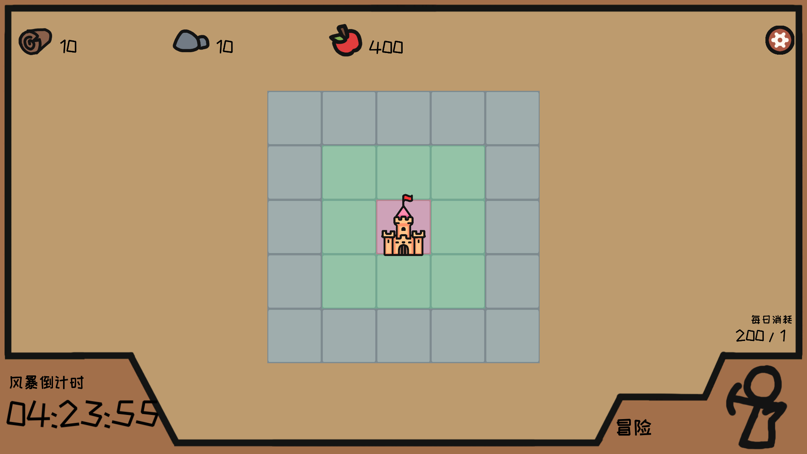

# Shelter 原工程对照修正

2026-10-17。用户指出旧复原中的树、石头地图和固定侧栏不属于原版。本次以提供的 Unity 工程 `E:/Github/Shelter` 的场景序列化引用及实际运行截图为准，修正素材、布局和交互。

## 原因与依据

旧导入器按图片文件名挑选了 `木头资源.png`、`石头资源.png`，没有解析 `SampleScene.unity` 的 GridManager 引用。这两个插画没有被原场景或 prefab 引用。原版地图实际绑定 `main.png`、`Resource.png`、`build.png`，分别是中央粉色、内圈绿色和外圈灰蓝色的方格。建筑三张原图均为 500×800，不能按正方形缩放。

只读复制原项目，使用对应的 Unity 2021.3.24f1c1 构建并运行，取得菜单、初始地图、农场/城墙建造预览、零人/一人派遣预览、设置七张参考截图。截图流程没有实际执行建造或派遣。为支持隐藏窗口捕获，截图时把原 Overlay Canvas 临时附加到原相机，再恢复；没有改动原游戏逻辑或原工程。截图方式与 SHA 核对记录在 `.engine/shelter-unity-reference/reference-notes.md`。

`scripts/extract-shelter-layout.py` 从原 YAML 提取 82 个场景节点、39 个素材引用及四个 prefab 的布局。`Reference/SceneBindings` 保存字节一致的场景及素材 GUID 元数据；回归测试直接检查这些绑定，防止以后再次按名称猜图。

## 本次修正

- 使用原场景绑定的彩色空地，恢复居中 5×5 网格与原比例主城、食物产出房、城墙。
- 使用原图菜单和按钮，恢复顶部资源、底部倒计时与右下派遣入口。
- 点击地块打开浮动建造预览，显示原建筑、材料费用、确认和取消。占用与资源不足提供具体原因；取消不扣费。
- 派遣通过独立窗口的人数滑块及确认/取消完成；快速点击轨道与持续拖动均可选人。探索结束自动弹出报告，确认后才领取，防止重复领取。
- 设置窗口暂停游戏、返回菜单、退出。倍速选项收进设置窗口，默认 1×，避免按空格意外切到 16×。全屏与嵌入模式共用等比坐标换算。
- 图片保留原文件字节，导入时避免额外 sRGB 解码造成变暗。报告文字避让图片中已有的标题。

仍有明确移植差异：生产统一到 63 秒时钟、风暴销毁不同建筑、原版屏幕边缘 UI 适度移入可操作范围。原粒子过渡为 1 秒准备、5 秒持续、2 秒淡出，共 8 秒；Tc 使用 9 秒预建雨带过渡，雨幕期间冻结模拟。详见下载工程 README；不声称逐像素一致。

另有交互细节差异：滑块人数取就近整数，原版向上取整；取消后重开窗口归零，原版仅隐藏窗口；报告显示本次派遣的总食物成本，原版显示损耗人数 × 200。

## 性能诊断与验收

新界面在旧锁定引擎 `5734c56` 上出现明显卡顿。真实浏览器 CPU 剖析定位到 WebGL `Clear()` 中的 `glGetFloatv(GL_COLOR_CLEAR_VALUE)`，4 秒采样约 3.6 秒消耗在该同步查询；并非数值模拟。旧界面历史性能数据不能证明本次界面的性能。

该问题已经由上游 [PR #33](https://github.com/chnnasn/TomCat_Engine/pull/33) 修复并合并。本次升级到 `c28487215bd5df89b35c1d68252ba240231d9c4f`，不重复提交同一补丁。为保证发布可复现，最终运行时逐字节复用已存在的 `web-engine-c2848721` release：190 个资源校验通过，manifest hash 为 `8f71d13105965ddc72de90989971b33c9521e6482b2633f4becb16179629eb19`。

另取消播放器弹窗背景的实时模糊，保留遮罩和其他弹窗样式。A/B 观测在本机 GPU 高负载时，嵌入播放器中位调用间隔约从 61 ms 降至 28 ms；这不是稳定帧率承诺。高性能 GPU 提示未改变浏览器实际选择的 Intel UHD，未将这个无实效的实验补丁写入正式代码。

普通鼠标回归的 29 个检查点通过，覆盖建造/取消、占用与材料不足、滑块快速点击与拖动上下限、派遣/取消/重开、报告不可被 P/Esc 绕过、领取不可重复、全屏、暂停冻结和重新开局。模型回归从原始资源通过 29 天六轮风暴；全仓 60 项测试通过，源码 ZIP 更新后样本测试再次 5/5 通过。

最终生产构建独立性能采样的各阶段 CPU P95 为 4.54–7.14 ms，通过 8 ms 预算；实际调用间隔 P95 为 62.97–126.55 ms，不能宣称稳定 60 FPS。同期观察到用户 Return Unity 6、壁纸与桌面合成器的 GPU 活动，未中断这些应用，也没有把该观察当成排除其他因素的因果证明。当前包为 54,589,589 字节，SHA-256 以 `803042` 开头。本次已发布，线上验收进行中；最终包、完整性能统计和后续线上结果以 [交付记录](shelter-delivery.md) 为准。

历史错误界面的发布及测量单独保留在 [旧版本交付记录](shelter-delivery-legacy.md)，不能用于描述当前画面或当前性能。
